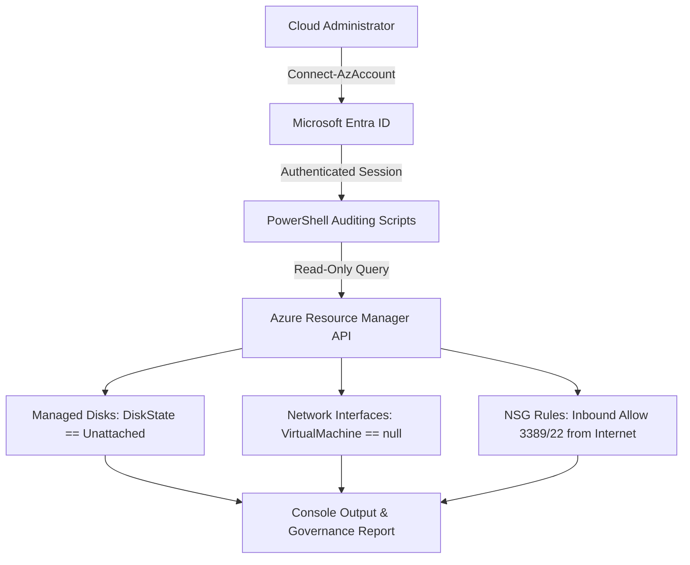

# Cloud Cost & Governance Automation

An operational automation project demonstrating proactive cost optimization and security auditing in Microsoft Azure using PowerShell.

This project provides automated discovery of idle resources and security misconfigurations. It targets common sources of wasted cloud spend (unattached disks, orphaned network interfaces) and governance risks (open management ports), demonstrating practical cloud operations and administration capabilities.

## Status and Technology


## Key Features and Highlights

- **Unattached Disk Detection:** Identifies Managed Disks with an `Unattached` state to prevent unnecessary storage billing.
- **Orphaned NIC Discovery:** Finds Network Interfaces not associated with any active Virtual Machine.
- **Security Governance Auditing:** Scans Network Security Groups (NSGs) for inbound rules exposing sensitive management ports (e.g., 3389 RDP, 22 SSH) to the internet.
- **Safe Execution:** Uses read-only queries ensuring zero impact on active production workloads.
- **Zero Embedded Secrets:** Relies entirely on the active Microsoft Entra ID authentication session.

## Architecture and Operations Workflow



1. **Authentication:** The Cloud Administrator authenticates to Azure via `Connect-AzAccount`.
2. **Execution:** The PowerShell scripts query the Azure Resource Manager (ARM) API.
3. **Filtration:** The scripts filter resources based on specific operational anomalies (e.g., `$null -eq $_.VirtualMachine`).
4. **Reporting:** Findings are output to the console for review before any destructive cleanup actions are taken.

## Security Architecture

The security model prioritizes identity-based access and the principle of least privilege:

- **Least Privilege (Azure RBAC):** The scripts require only the `Reader` role at the Subscription or Resource Group level. They cannot modify or delete resources.
- **No Embedded Secrets:** Authentication relies entirely on the active `Connect-AzAccount` session (Microsoft Entra ID). No service principal client secrets, passwords, or tokens are hardcoded.
- **Non-Destructive Operations:** The scripts perform read-only operations to ensure safety during the auditing phase.

## Cost Optimization and Governance

This project directly addresses cloud governance and FinOps principles:

- **Cost Drivers:** In Azure, resources like Managed Disks incur charges regardless of whether they are attached to a running VM. Orphaned NICs clutter the environment and can consume IP allocations.
- **Automated Discovery:** By programmatically identifying these resources, administrators can safely review and delete them to reduce monthly cloud waste.
- **Safe Lab Strategy:** The scripts were built and tested using a temporary, low-cost isolated resource group (`rg-cost-gov-lab`) containing minimal SKUs (1GB Standard HDD), which was immediately destroyed after validation to ensure zero ongoing costs.

## Testing and Validation

The logic was validated in an isolated Azure environment (`germanywestcentral`) containing intentionally misconfigured and orphaned resources.

**Observed Validation Results:**

- **`unattached-disks.ps1`**: Successfully identified `disk-lab-unattached` (1GB Standard_LRS) with `DiskState = Unattached`.
- **`orphaned-nics.ps1`**: Successfully identified `nic-lab-orphaned` with `ProvisioningState = Succeeded` and no attached VM.
- **`vulnerable-rules.ps1`**: Successfully detected the inbound rule `Allow-RDP-Internet` in `nsg-lab-vulnerable` exposing port `3389` to `*`.

## Usage Instructions

### Prerequisites

- Windows PowerShell or PowerShell 7+.
- The `Az` PowerShell module installed (`Install-Module -Name Az -Repository PSGallery -Force`).
- An active Azure Subscription with at least `Reader` permissions.

### Execution

1. Authenticate to your Azure environment:

```powershell
Connect-AzAccount
```

2. (Optional) Set your target subscription context:

```powershell
Set-AzContext -SubscriptionId "YOUR_SUBSCRIPTION_ID"
```

3. Run the auditing scripts from the repository root:

```powershell
.\scripts\unattached-disks.ps1
.\scripts\orphaned-nics.ps1
.\scripts\vulnerable-rules.ps1
```

### Lab Cleanup

After validating the scripts against the test environment, the temporary resource group was removed to prevent ongoing charges:

```powershell
Remove-AzResourceGroup -Name "rg-cost-gov-lab" -Force -AsJob
```

## Repository Structure

```text
azure-cost-governance-automation/
├── scripts/
│   ├── unattached-disks.ps1
│   ├── orphaned-nics.ps1
│   └── vulnerable-rules.ps1
└── README.md
```

## Technical Decisions and Trade-offs

- **PowerShell vs. Azure CLI:** PowerShell was selected for its native object-pipeline manipulation, making it straightforward to filter nested resource properties such as NSG security rules without external JSON parsing tools.
- **Read-Only Auditing vs. Auto-Remediation:** The scripts strictly report findings rather than automatically deleting resources. In production operations, auto-deleting unattached disks carries high risk if a disk was temporarily detached for maintenance, migration, or troubleshooting.

## Technologies Used

- **Cloud Platform:** Microsoft Azure
- **Compute & Storage:** Azure Managed Disks
- **Networking:** Azure Virtual Network, Network Interfaces (NIC), Network Security Groups (NSG)
- **Identity & Security:** Microsoft Entra ID, Azure RBAC
- **Automation:** PowerShell, Azure PowerShell (`Az`) Module

